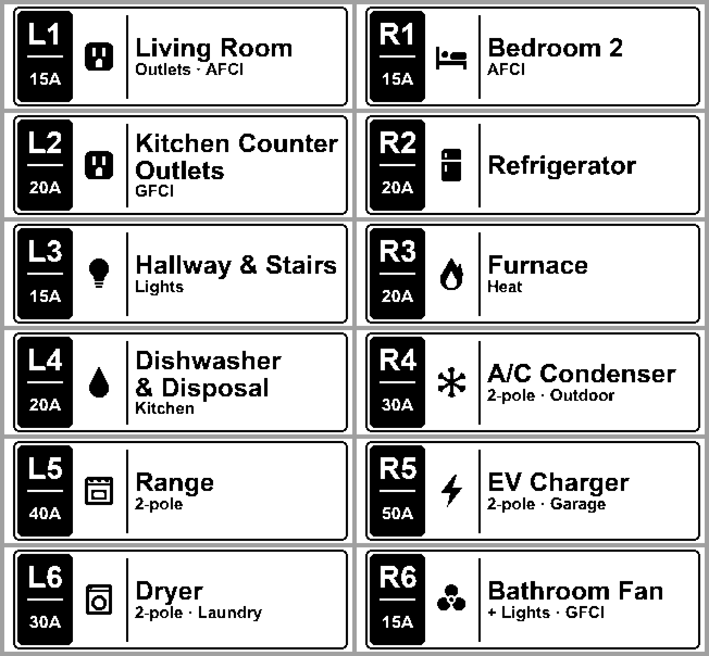

# nelko-p21-ble-labels

Print crisp, pixel-exact labels on a **Nelko P21** thermal label printer from your computer over
**Bluetooth LE**, with no phone app. It also includes a generator for clean breaker-panel labels
from a CSV file.



- **`p21_ble.py`**: prints any PNG over Bluetooth LE, and checks printer status and the loaded roll.
- **`make_labels.py`**: turns a CSV of circuits into 1-bit labels sized 1:1 to the print head,
  with 12 built-in icons.
- **`check_labels.py`**: checks that labels will print unscaled and inside the margins, and
  builds a preview sheet.
- **`docs/CLAUDE_LABEL_HANDOFF.md`**: a prompt for having Claude (or another AI assistant)
  design new labels to this spec.

Tested on macOS with a P21 and a 14 x 40 mm roll. `bleak` also supports Linux and Windows, but
the BLE print path hasn't been tested there yet. Reports are welcome.

## Why Bluetooth LE?

On macOS the P21's classic Bluetooth serial port (`/dev/cu.P21`) often shows as connected but
never passes data. The printer also speaks Bluetooth LE, which is what the official app uses,
and that link works reliably. This project drives the printer over LE. It reuses the protocol
work and job building from
[merlinschumacher/nelko-p21-print](https://github.com/merlinschumacher/nelko-p21-print), which is
included unmodified as `p21_print.py`.

## Quick start

Requirements: Python 3.10+ and a Nelko P21.

```bash
git clone <this repo> nelko-p21-ble-labels
cd nelko-p21-ble-labels
./print.sh --status
```

`print.sh` creates a virtual environment and installs `bleak`, `pillow` and `pyserial` on its
first run. On Windows, run `python -m venv .venv`, then `.venv\Scripts\pip install -r requirements.txt`,
then use `.venv\Scripts\python p21_ble.py ...` instead of `./print.sh ...`.

`--status` should print something like:
```
Found P21; connecting...
Status: Ready
Label: 14x40 mm, Gapped, White, gap 5 mm (paper code ...)
```

Then print a sample:
```bash
./print.sh --labels-dir examples/breaker-panel/labels L1      # one label
./print.sh --labels-dir examples/breaker-panel/labels --all   # all 12 samples
```

### Before you print

- **Close the Nelko phone app or turn off the phone's Bluetooth.** The printer accepts one
  connection at a time.
- **Don't connect the printer in your computer's Bluetooth settings.** It only advertises
  over LE while no classic Bluetooth link is up. If it shows as connected, disconnect or forget
  it there.
- **macOS:** run from **Terminal.app** (or iTerm), and click Allow when macOS asks for Bluetooth
  access. Python started from an app without that permission gets killed instantly, with no
  output and exit code 134. Some IDE and AI-assistant terminals behave this way.

## Make your own labels

1. Copy the example CSV and edit it:
   ```bash
   cp examples/breaker-panel/labels.csv my_panel.csv
   ```
   | Column | Meaning |
   |---|---|
   | `id` | Circuit ID shown in the badge, and the file name (`L1` becomes `L1.png`) |
   | `amps` | Shown under the ID, e.g. `20A` or `30/40` |
   | `title` | Main text. ` / ` marks where to break onto two lines; otherwise it wraps automatically if needed |
   | `subtitle` | Optional second line, e.g. `GFCI · Kitchen` |
   | `icon` | `bed`, `bolt`, `bulb`, `drop`, `fan`, `flame`, `fridge`, `outlet`, `plug`, `snowflake`, `stove`, `washer`, or empty |
2. Generate, check, then print:
   ```bash
   .venv/bin/python make_labels.py my_panel.csv -o labels
   .venv/bin/python check_labels.py labels                 # writes labels/preview.png
   ./print.sh L1                                           # test one (labels/ is the default folder)
   ./print.sh --all
   ```

The generator picks the largest text size that fits. It reports any label that hit the minimum
size or had its subtitle shortened. Fonts: Arial Bold on macOS and Windows, DejaVu Sans Bold on
Linux, or pass `--font-bold path/to/font.ttf`.

**Other label lengths:** `make_labels.py --length-mm 30` and `check_labels.py --length-mm 30`.
The text column shrinks with the label, so keep text short: the generator lists any label that doesn't fit. The width is always 96 dots, the head's 12 mm print
width.

**Your own artwork:** any PNG works, e.g. `./print.sh sticker.png`. For sharp results, make it
exactly *length x 8* by 96 pixels (320 x 96 for a 40 mm label), pure black and white, with a
little white space at the edges. Anything else gets scaled to fit. Use `--render dither` for
photos.

## Printing options

```
./print.sh --help
  labels               label names (looked up as <labels-dir>/<name>.png) or image files
  --labels-dir DIR     folder for names and --all (default ./labels)
  --all                every PNG in the folder, in natural order (L2 before L10)
  --status             printer status and loaded roll only
  --label-size WxL     override the roll size in mm (default: read from the roll's tag)
  --density N          darkness 1-15 (default 12; lower if text bleeds, higher if faint)
  --copies N           copies of each label
  --render dither      dithered rendering for photos (default crisp)
  --selftest           printer's built-in test page
  --debug              log every reply from the printer
```

## Troubleshooting

| Symptom | Fix |
|---|---|
| `No Bluetooth LE device named 'P21' found` | The printer is off, a phone is connected to it, or your computer has a classic Bluetooth link to it. Close the app, turn off the phone's Bluetooth, disconnect the P21 in your Bluetooth settings, and turn the printer off and on. |
| Python exits immediately with no output (macOS, exit 134) | No Bluetooth permission. Run from Terminal.app and allow Bluetooth access. |
| `Status: Ready` but nothing prints | Don't lower `--chunk` below about 120. The printer ignores TSPL commands split across writes. |
| A label spills onto the next one | The image is longer than the roll. Check `--status`, and generate with the matching `--length-mm`. |
| Text too dark or blurry | Lower `--density` (try 10–12). |
| Text faint or broken | Raise `--density`, or make strokes at least 2 px wide. |
| The first label after a misprint is out of position | Open and close the lid, or feed one blank label. |

## How it works

The P21 exposes GATT service `ff00`:

| Characteristic | Use |
|---|---|
| `ff02` | Commands in (write without response) |
| `ff01` | Replies (notify) |
| `ff03` | Flow-control credits (notify). Never seen any credits on macOS |

- **Print jobs** are TSPL: `SIZE`, `GAP`, `DIRECTION`, `DENSITY`, `CLS`, `BITMAP` (1 bit per
  pixel, MSB first, 0 = black), then `PRINT`.
- **Each command line has to arrive in a single BLE write.** Jobs sent in 20-byte chunks are
  silently ignored. `p21_ble.py` sends 180-byte chunks (MTU 185) paced 0.06 s apart.
- **Status queries** `ESC ! ?` (status byte) and `ESC ! o` (16-byte roll info from the NFC tag)
  need a trailing CRLF over LE.
- **Resolution:** the head is 203 dpi (8 dots/mm) and 96 dots wide (12 mm), so a 40 mm label is
  a 96 x 320 bitmap. Labels are designed landscape and rotated before sending.

## Credits and license

- `p21_print.py` is unmodified from
  [merlinschumacher/nelko-p21-print](https://github.com/merlinschumacher/nelko-p21-print),
  licensed AGPL-3.0. See that project for the full protocol reverse-engineering.
- The rest of this project builds on it and is also released under the
  **GNU Affero General Public License v3.0**. See [LICENSE](LICENSE).
- Not affiliated with or endorsed by Nelko.
